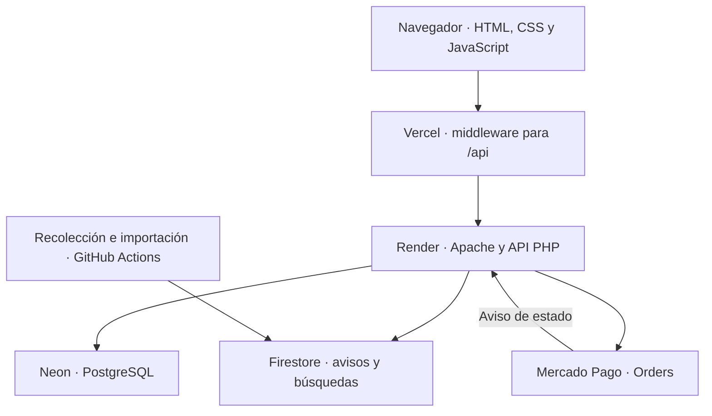
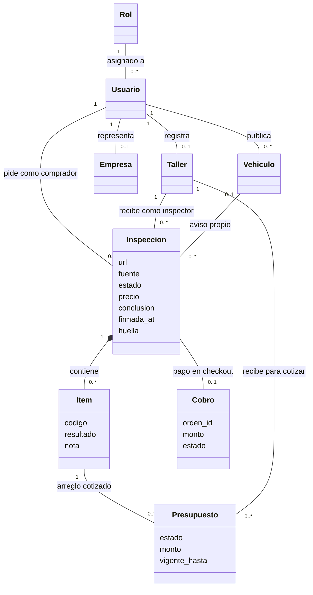
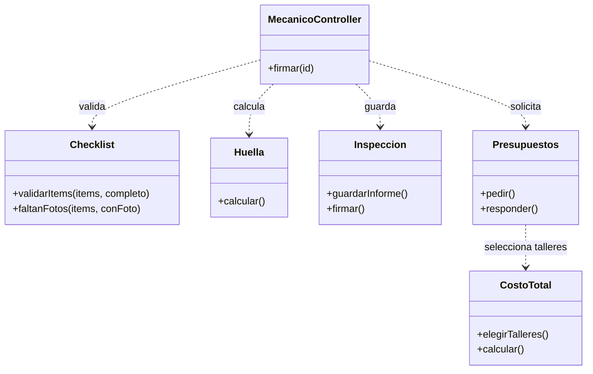

# Arquitectura y modelo de objetos · Entrega final

## Desde el navegador hasta los datos

El navegador consume la API en el mismo origen. En PHP, el router aplica los permisos antes de pasar al controlador. Por ejemplo, al firmar un informe, el controlador comprueba quién es el mecánico y el estado del pedido, valida el checklist y guarda la firma y los pedidos de presupuesto en una transacción. Al volver del checkout, el servidor consulta el estado de la orden al proveedor. Las publicaciones propias, los eventos de uso y los cobros se guardan en PostgreSQL. La importación de avisos externos y las consultas del metabuscador usan la base de documentos.

## Modelo del dominio

**Cómo leer el modelo.** El comprador y el mecánico son usuarios distintos. En PostgreSQL el taller se identifica por su `usuario_id`. Un pedido para un aviso externo conserva la URL y la fuente, y puede carecer de `vehiculo_id`. Cada cotización identifica inspección, ítem y taller. El taller que revisó el auto queda excluido de esa ronda.

**Ejemplo de objetos.** Una compradora elige un taller para revisar un Fiesta encontrado en el metabuscador. Su inspección apunta al aviso externo. El ítem «frenos» guarda lo que el taller observó en ese Fiesta. Otro taller recibe el pedido de presupuesto para ese mismo ítem. Cuando responde con una oferta vigente, el comprador la ve en el informe. El dato de que otros Fiesta tuvieron problemas de frenos se calcula por modelo y se muestra por separado.

## Del modelo al código

En la API, el controlador coordina clases con responsabilidades distintas. La huella se calcula a partir del contenido que se va a firmar; luego se persiste el informe y se solicitan las cotizaciones.

| Responsabilidad | Componentes del backend | Datos |
|---|---|---|
| Pedir y firmar | `Inspecciones/Pedido`, `MecanicoController`, `Checklist` y `Huella` | Pedido, ítems, fotos y firma |
| Cotizar y orientar | `Presupuestos`, `CostoTotal` y `FallasTipicas` | Ofertas por ítem y observaciones por marca y modelo |
| Mostrar la verificación | `Catalogo/Verificacion` | Última inspección firmada en los últimos 90 días, conclusión y coincidencia con los datos actuales del aviso |
| Cobrar la inspección | `Pagos/Cobros` y `MercadoPago` | Orden y estado del proveedor vinculados a la inspección |
| Interpretar el uso | `Estadisticas`, `Afiliacion` y `Empresas` | Eventos, preferencias, inspecciones, clics y liquidaciones |
